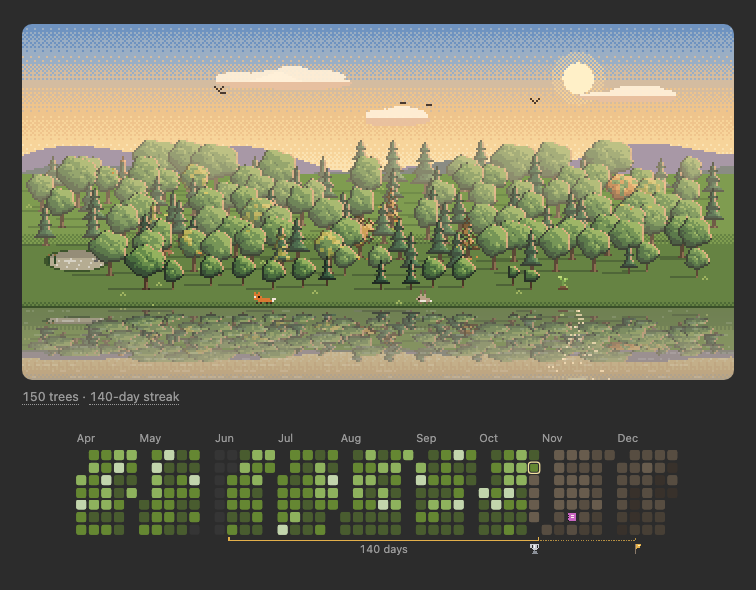
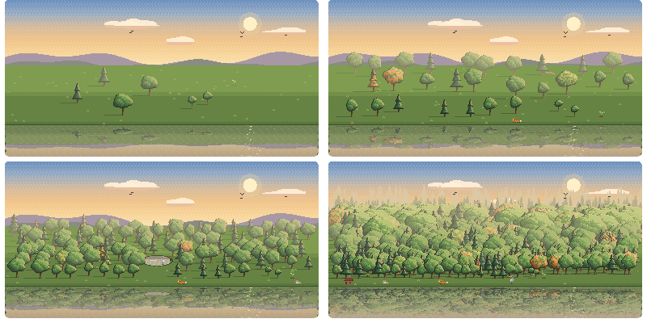
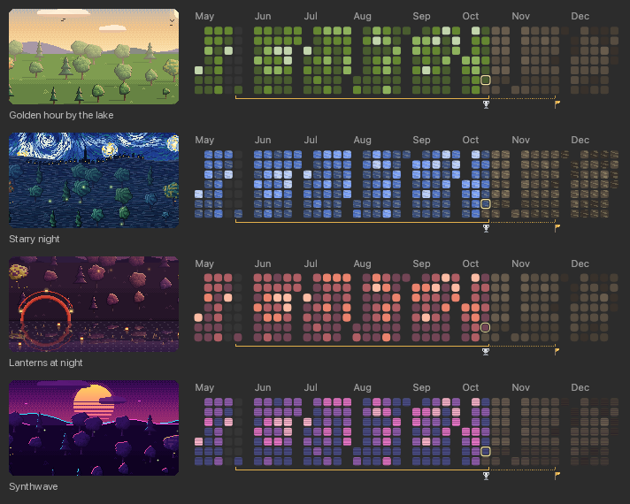
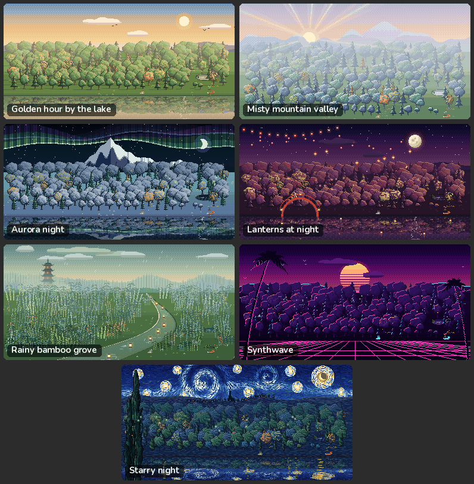
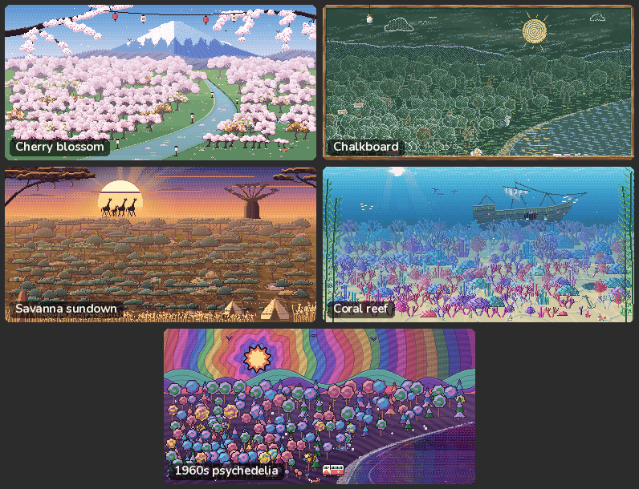
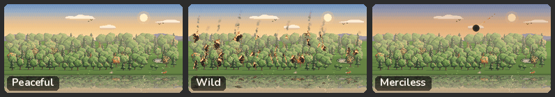
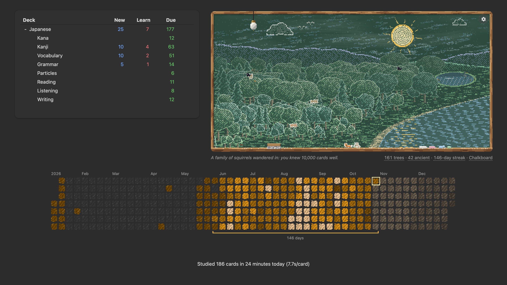
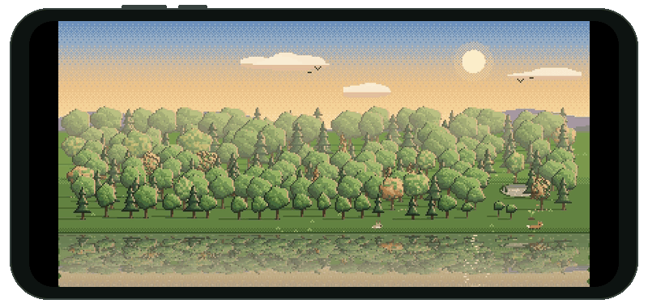

# Memory Forest

**A forest and a study heatmap that grow from your Anki study history.** Every day you learn new
cards plants a tree below your deck list, and the heatmap under it shows the days you studied,
your streak and the reviews ahead. There is nothing to click and nothing to manage: just study,
and watch it grow.

**[Get it on AnkiWeb](https://ankiweb.net/shared/info/1255432496)** · add-on code `1255432496`

## How the forest grows

 
<i>After a week, a month, four months and four years.</i>

A tree starts as a seedling and grows as you come to know its day's cards, and the days you
know best keep growing for years, into ancient giants. Forget some of a day's cards and its tree
gets a few yellow leaves, which turn green again once you relearn them. Trees never die. Days
when you only review don't plant a tree, but they keep the ones you have healthy.

So its size is how much you have learned, and its colour is how well you remember it. Point at a
tree to see its day. Take a week off and a pond appears where the missing days would be; keep
studying and animals move in, and after a year a little cabin appears at the edge of the woods.

## Your study heatmap

Your study days, streaks and upcoming reviews, in your scenery's colours. Hover for details;
click a day to open its cards.

- **Views**: a rolling timeline, a full year, or your whole streak at once.
- **Select days**: Shift-click or Ctrl/Cmd-click days to light up their trees, then click one to open all their cards.
- **Reviews, time or pace**: shade days by review count, study time or seconds per answer.
- **Per deck**: each deck has its own heatmap and streak.
- **Fair streaks**: days with nothing due don't break your streak; or choose a 5- or 6-day study week.
- **Trophies**: medals for your three longest streaks, and a flag for your next goal.
- **Milestones and important days**: see when each animal joined, and right-click to mark exams and trips.
- **Your look**: its colours and style in the Heatmap tab, and a week that starts on Monday, Sunday, Saturday or your system's setting.

## Pick your scenery

### New in Memory Forest Plus

These arrive in Memory Forest Plus first, and come to this version later on.
[Join on Patreon](https://www.patreon.com/BarakLevy) to get them now.

## How you study

Good days leave something behind for you to find. Whether bad habits leave a mark too is up to
you: pick a **Nature** on the Forest tab of the settings.

- **Peaceful** (the default): only the good things. Days away cost you nothing.
- **Wild**: bad habits leave marks until you fix them. Miss two days in a row and smoke rises as a
  warning; miss a third and a fire spreads while you stay away. A weekend off is fine. Seven days
  of study put it out.
- **Merciless**: a single day without reviews brings down an asteroid on the whole forest, and a
  new one grows from there. Bad habits leave their marks too.

Switch back at any time and your forest is just as it was.

## Layout

Choose where the forest and the heatmap sit on the Forest tab of the settings.

## On your phone

Turn on "Show my forest on my phone" on the Forest tab. After your next sync, a Memory Forest deck
in AnkiDroid shows your forest and heatmap. Your computer draws this copy, so it updates whenever
Anki syncs there.

## Compatibility and privacy

- Anki 2.1.45 or later, on a computer (Windows, macOS, Linux). AnkiDroid can show a copy
  of your forest that your computer sends it (see On your phone).
- Using [Onigiri](https://ankiweb.net/shared/info/1011095603)? It hides the forest until you add
  it to its grid: [here's how](docs/onigiri/README.md).
- Everything is computed on your computer from your own review history. The only thing that
  leaves it is your city's name, and only if you turn on the real weather: it is sent to
  [Photon](https://photon.komoot.io) (OpenStreetMap, free, no account) to find the place, and its
  coordinates to [MET Norway](https://api.met.no) (free, no account) for the forecast. The copy of
  your forest for your phone goes through your own AnkiWeb sync, like any card.

## Languages

Memory Forest follows your Anki's language: German, Spanish, French, Brazilian Portuguese,
Japanese, Chinese (Simplified), Arabic and Hebrew, right to left where the language reads so. The
translations were made with AI and no native speaker has read them yet, so they're probably bad
in places: if something reads wrong in your language, please [tell me](TRANSLATING.md).

## Support and feedback

If you enjoy Memory Forest, please [give it a thumbs up on AnkiWeb](https://ankiweb.net/shared/review/1255432496)
and share it with friends who study with Anki. Want each new scenery first?
[Join on Patreon](https://www.patreon.com/BarakLevy) for Memory Forest Plus.

Found a bug or have an idea? [Open an issue](https://github.com/baraklevy20/memory-forest/issues).

## License and development

[MIT](LICENSE). Developing it yourself? See [DEVELOPMENT.md](DEVELOPMENT.md).
