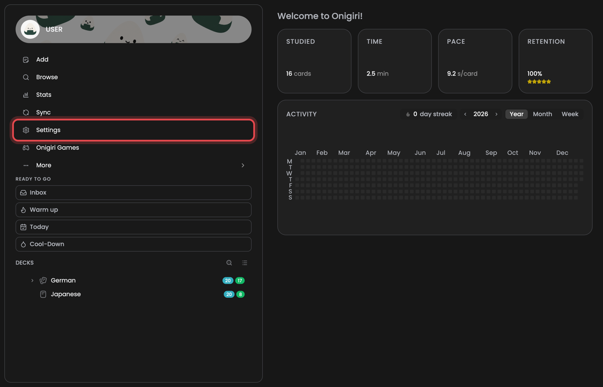
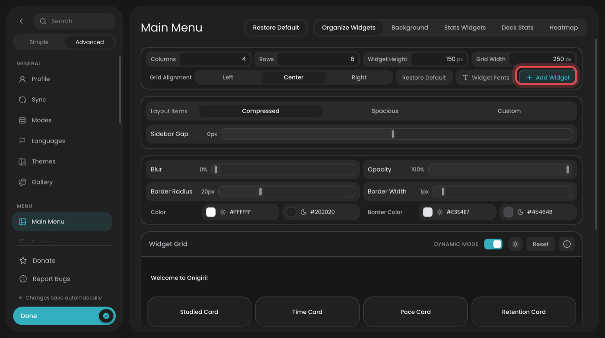
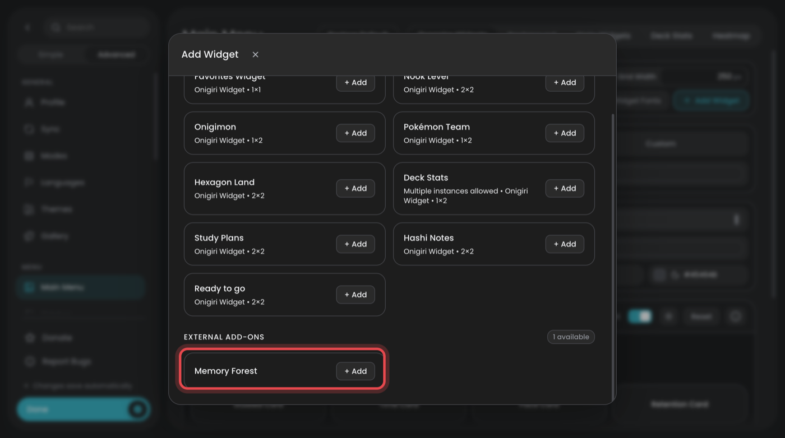
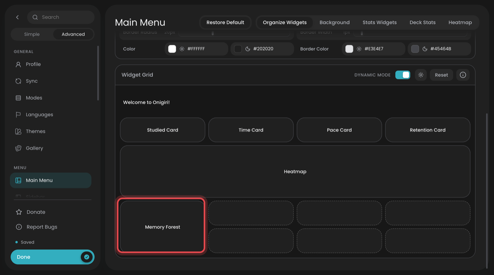
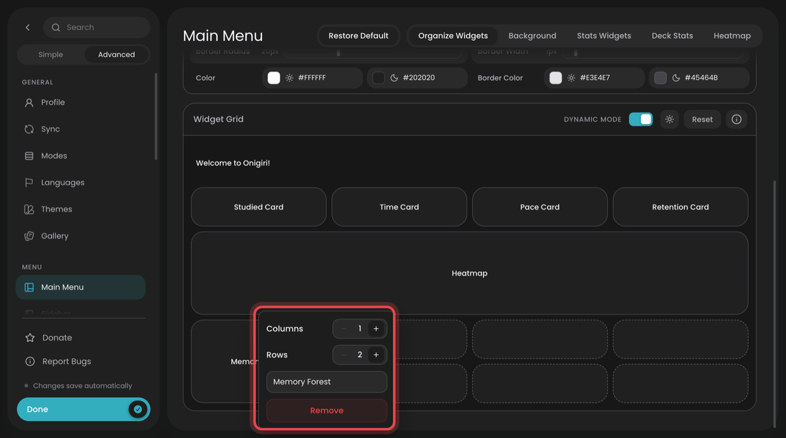
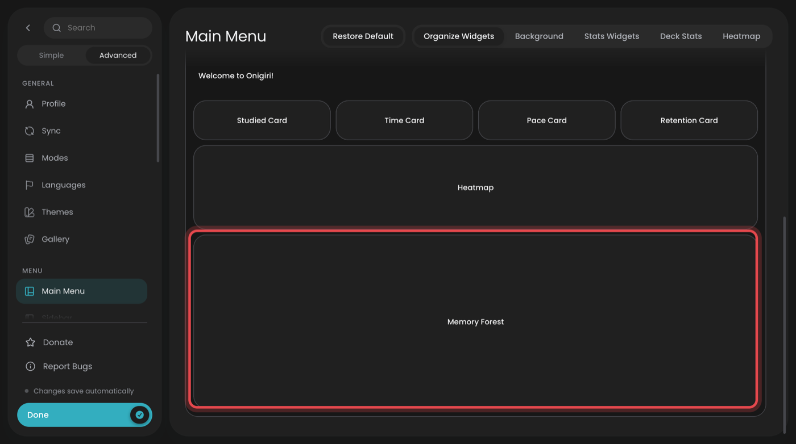
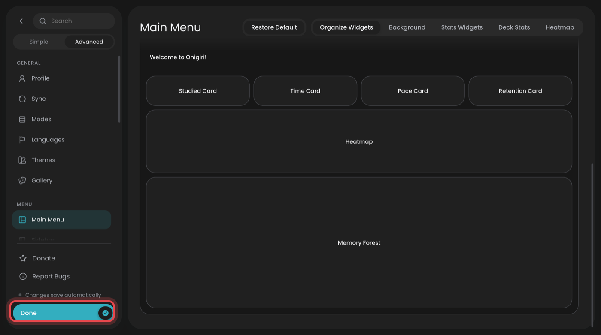
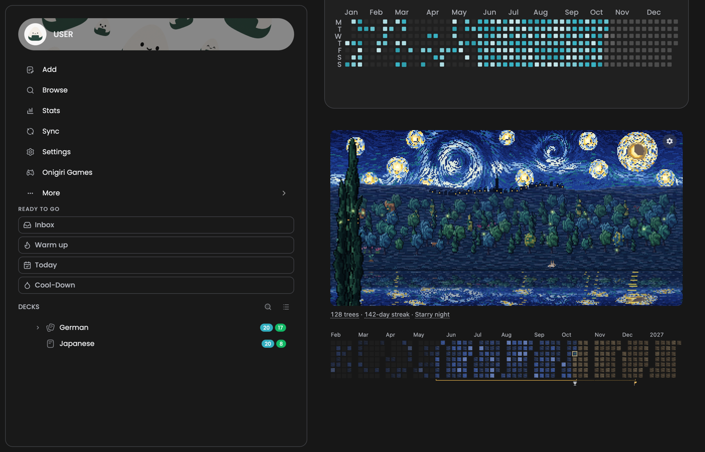
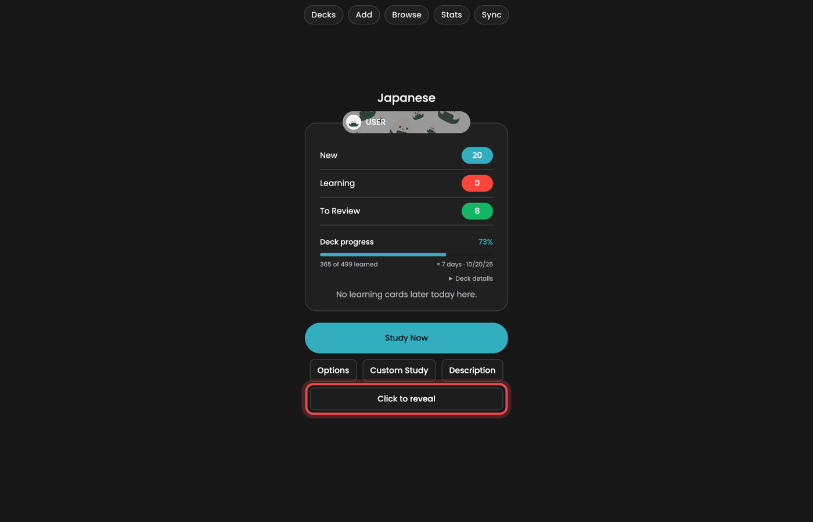
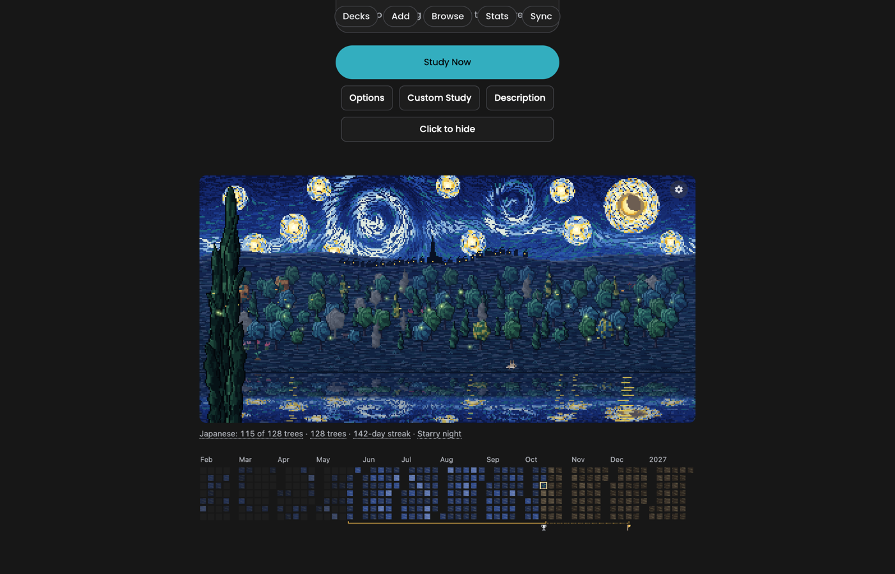

# Memory Forest with Onigiri

[Onigiri](https://ankiweb.net/shared/info/1011095603) replaces Anki's deck list with its own
grid of widgets. It keeps other add-ons' panels, but puts each one away until you place it
on the grid yourself. That's why the forest seems to disappear once Onigiri is installed.
It only takes a minute to bring it back, and no code.

Tested with Onigiri 2.0.2 in Anki 26.09.

## 1. Open Onigiri's settings

With Onigiri installed, the deck list has no forest. Click **Settings** in Onigiri's
sidebar.

## 2. Click Add Widget

Settings opens on **Main Menu → Organize Widgets**. Click **+ Add Widget**.

## 3. Add Memory Forest

Scroll to **External Add-ons** at the bottom of the list and click **Memory Forest**.

## 4. Make the tile bigger

Memory Forest is now on the grid, at the bottom, as a small tile one column wide.
Right-click the tile.

Use the **+** buttons to set **Columns** to the full width of your grid (4 by default)
and **Rows** to 4. A narrow tile shows a very small forest, and a lower one cuts off the
study calendar under it.

The tile now spans the whole grid. You can drag it to another place if you like.

## 5. Click Done

Changes are saved straight away. Click **Done** to close the settings.

## That's it

The forest is back on the deck list, inside Onigiri's grid, and grows as usual.

## On a deck's own screen

Onigiri hides other add-ons' content on a deck's screen behind a **Click to reveal** button
under Study Now. Click it to show the forest. Click **Click to hide** to put it away again.

## Notes

- 4 rows is the most a tile can have. If the bottom is still cut off, raise Onigiri's
  **Widget Height** at the top of Organize Widgets, which makes every row taller.
