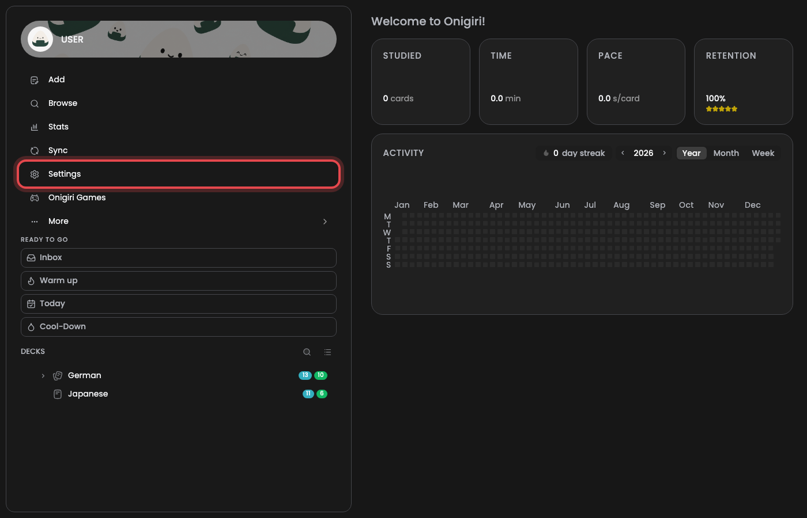
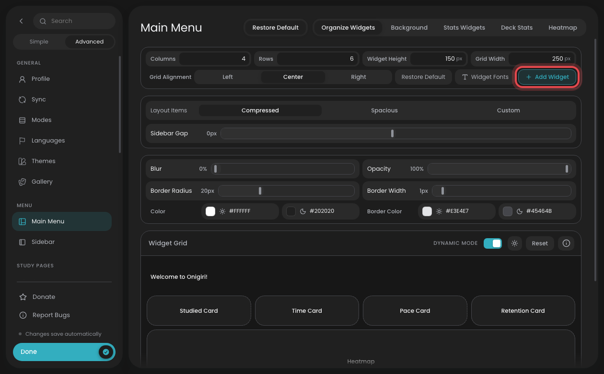
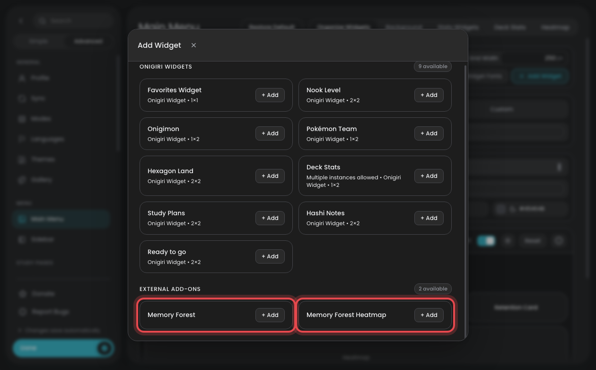
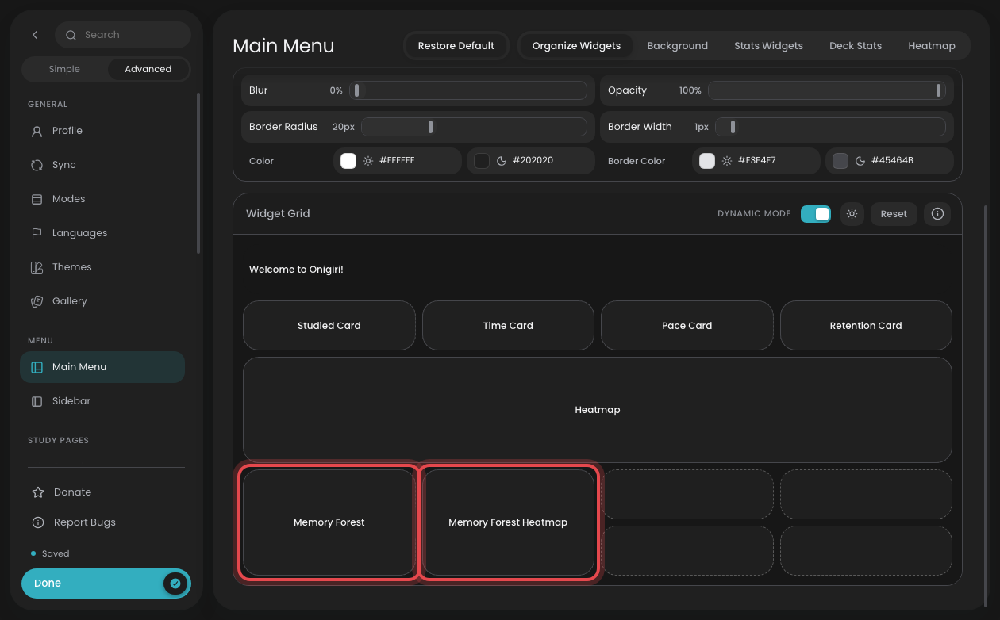
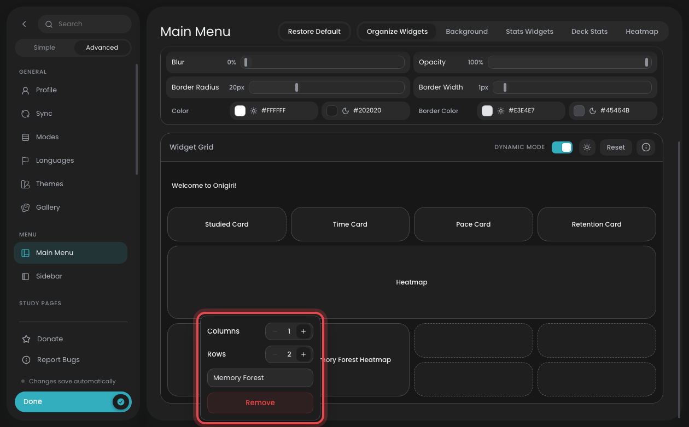
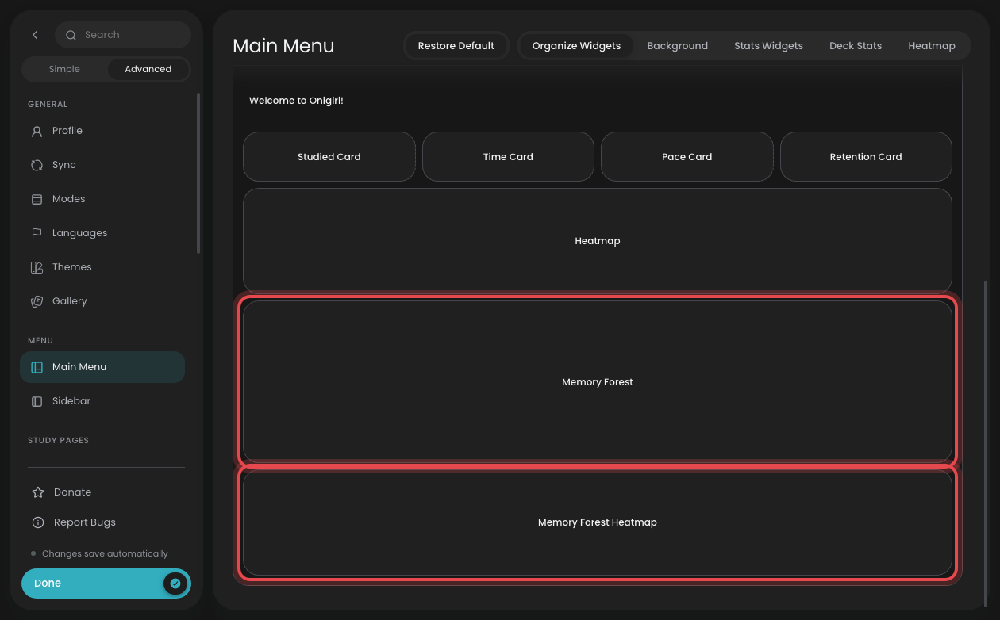
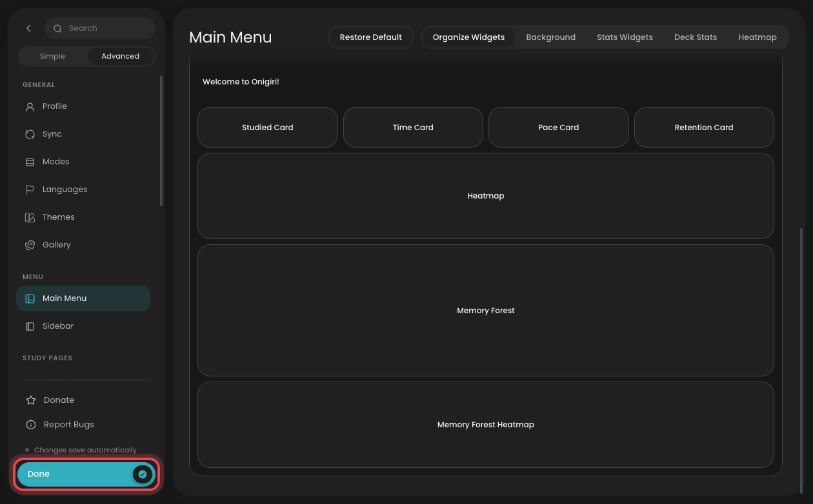
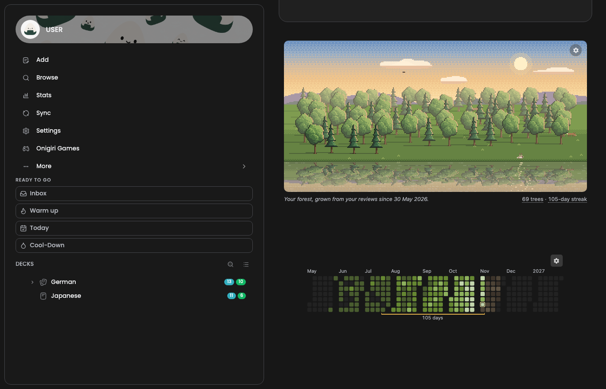
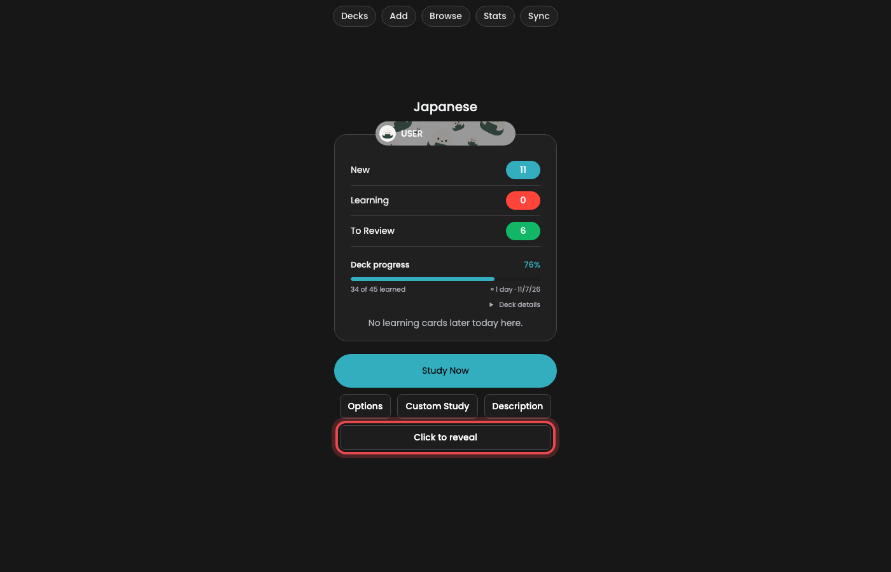
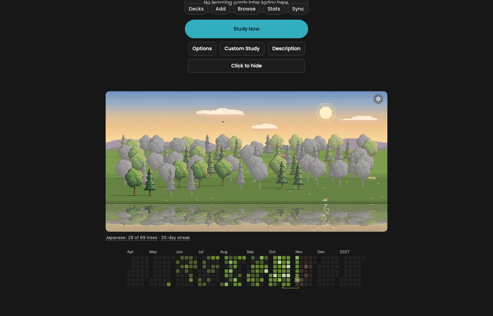

# Memory Forest with Onigiri

[Onigiri](https://ankiweb.net/shared/info/1011095603) replaces Anki's deck list with its own
grid of widgets. It keeps other add-ons' panels, but puts each one away until you place it
on the grid yourself. That's why the forest seems to disappear once Onigiri is installed.
It only takes a minute to bring it back, and no code.

Tested with Onigiri 2.0.2 in Anki 26.09.

## 1. Open Onigiri's settings

With Onigiri installed, the deck list has no forest. Click **Settings** in Onigiri's
sidebar.

## 2. Click Add Widget

Settings opens on **Main Menu → Organize Widgets**. Click **+ Add Widget**.

## 3. Add Memory Forest and its heatmap

Scroll to **External Add-ons** at the bottom of the list. Memory Forest has two tiles there:
**Memory Forest** for the forest, and **Memory Forest Heatmap** for the study heatmap
(with Memory Forest Plus: **Memory Forest Plus** and **Memory Forest Plus Heatmap**).
Click **Memory Forest**. The list closes, so click **+ Add Widget** again and click
**Memory Forest Heatmap**.

## 4. Make the tiles bigger

Both tiles are now on the grid, at the bottom, each one column wide.

Right-click the Memory Forest tile and use the **+** buttons to set **Columns** to the full
width of your grid (4 by default) and **Rows** to 3. A narrow tile shows a very small forest.
Then set the Memory Forest Heatmap tile to the same **Columns**, and **Rows** to 2.

The tiles now span the whole grid. You can drag them to other places if you like.

You can also skip the heatmap's tile: the heatmap then stays in the forest's tile, under the
forest. That tile needs **Rows** 4, or the heatmap is cut off.

## 5. Click Done

Changes are saved straight away. Click **Done** to close the settings.

## That's it

The forest and its heatmap are back on the deck list, inside Onigiri's grid, and grow as usual.

To put the heatmap back under the forest, remove the Memory Forest Heatmap tile.

## On a deck's own screen

Onigiri hides other add-ons' content on a deck's screen behind a **Click to reveal** button
under Study Now. Click it to show the forest. Click **Click to hide** to put it away again.

## Notes

- 4 rows is the most a tile can have. If the bottom of a tile is still cut off, raise
  Onigiri's **Widget Height** at the top of Organize Widgets, which makes every row taller.
